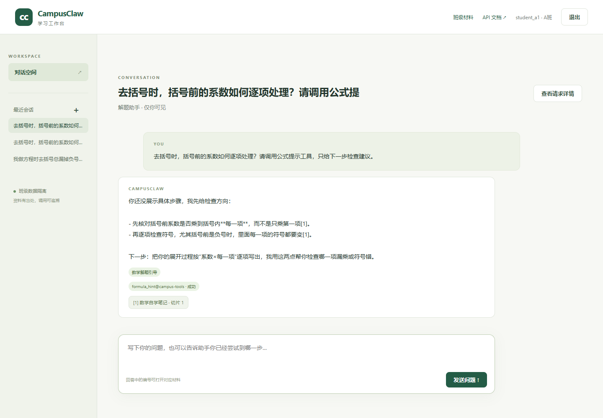

# CampusClaw 个人项目阶段性验收报告

这次是在原有 CampusClaw 班级材料与知识库问答项目上继续开发，主要完成第5课的提示词、技能和流式会话，以及第6课的 MCP 工具接入。项目仍使用原生 HTML、CSS 和 JavaScript 编写前端，Go 编写后端，MySQL 保存用户、材料和对话记录，Docker Compose 负责启动各个服务。原来的登录、班级权限和材料检索继续使用，在此基础上增加了多个学习助手。

项目 Git 仓库地址为 https://github.com/shiqipzy/campusclaw-coursework。下面结合当前代码和运行记录，说明一次对话怎样使用提示词、知识库、技能和外部工具，以及实际发送给模型的内容。

## 一、多个助手与提示词模板

系统内置了解题助手、作业诊断助手和学习计划助手。它们使用同一套对话接口，但各自保存角色提示词，并绑定不同的技能和材料。例如，解题助手主要引导学生检查解题步骤，作业诊断助手使用批改和错题讲解技能，学习计划助手则根据目标给出学习安排。教师可以在页面中修改这些配置，也可以新建助手。

智能体数据保存在 tutor_agents 表中，技能和材料的绑定分别放在 tutor_agent_skills 和 tutor_agent_materials 表中。新建会话时，后端把选中的 agent_id 写入 conversations。后续提问都从会话读取这个编号，不再接受客户端临时更换助手；会话本身还要按当前用户和班级校验，其他用户不能直接读取。

提示词模板的作用是提供可编辑的初始文字。页面通过 /api/prompt-templates 取得“循序引导”“证据批改”“学习规划”等模板，教师选用后，文字填入角色提示词并保存。回答时，chat.go 中的 systemPrompt 读取该助手当前的 prompt，把它放进 system 消息。因此，模板套用后的文字会传给 LLM，但模板列表和模板名称不会额外发送。提示词留空时，程序使用默认的学习助手设定。

## 二、一次对话实际发送给模型的内容

学生提问对应 POST /api/conversations/{id}/messages，请求体包含 question，长度为2至500个字符。chat.go 中的 sendMessage 完成身份和会话校验后，读取助手配置、选择技能并检索资料，再调用 modelExchange 请求 DeepSeek 的 /chat/completions 接口。本次记录中，工具决策请求的固定参数如下，messages 和 tools 的组成分别在下文说明：

```text
model: deepseek-flash
max_tokens: 1200
thinking: {"type": "disabled"}
stream: false
tool_choice: auto
```

messages 的第一条是 system 消息，包含角色提示词、选中技能的名称和说明，以及引用资料和回答方式的约束。随后是最近最多6条历史消息，每条最多保留500个字符；最后一条 user 消息放当前问题和检索到的材料。首次提问没有历史记录，因此最初只需要 system 和 user 两条消息。知识库正文放在 user 中，不与角色提示词混在一起。

这次验证使用的问题是“我在解方程去括号时总漏掉负号，请使用公式提示工具，只给下一步检查建议，不要给最终答案。”首轮请求带有两个候选工具。模型没有立即给出正文，而是在 choices[0].message.tool_calls 中选择了 formula_hint__campus_tools，参数为 {"topic": "去括号"}，finish_reason 为 tool_calls。该次返回还记录了 prompt_tokens 为776、completion_tokens 为45、total_tokens 为821。

工具处理完后，宿主把模型提出的调用和工具返回追加到 messages，再请求模型组织正文。最终请求把 stream 改为 true，不再携带工具声明。后端从上游 SSE 的 choices[0].delta.content 读取新增文字，再转成浏览器能接收的 delta 事件。前端通过 fetch 读取响应流，并按顺序拼接，而不是等待整段回答后再一次性显示。

浏览器最先收到的 meta 事件包含本轮技能和引用，发生工具调用时还会先收到 tool_calls 事件。正文随后通过多次 delta 到达，保存助手消息后才发送 done。Nginx 关闭了代理缓冲，后端每写一帧也会刷新连接。页面的“查看请求详情”读取 llm_exchanges 中保存的请求 JSON 和模型返回；访问权限仍限定为会话本人，鉴权请求头不写入这份记录。

## 三、知识库绑定后传递哪些资料

绑定知识库并不表示每次都把整个知识库交给模型。原始材料和切片仍保存在 MySQL 中，agentKnowledge 只查询当前班级、当前助手绑定的材料。检索沿用 ngram 全文索引，先按匹配分数取最多24个候选，再检查问题与切片是否有连续文字重合；如果选中技能填写了“资料”字段，还会按材料标题进一步筛选，最终最多保留4个切片。

发送前，程序给保留的切片连续编号，并附上材料标题、切片号和字符位置，每片最多800个 Unicode 字符。本次提问命中了《数学自学笔记》的一个切片，发送的正文包括去括号时系数要乘到每一项、负号应逐项检查等内容。其他材料和未命中的切片没有进入本轮请求。因此，模型看到的是与当前问题有关的一小部分资料，而不是整份材料库。

回答中的 [1] 与 meta 返回的第一条来源对应。点击来源按钮后，前端仍通过材料详情接口读取原文，后端再次检查班级权限。在接口验证中，B班账号即使传入 class_id=1，搜索只存在于A班材料中的“蓝杉数学”，结果也为空，说明资料范围由服务端决定。

检索没有命中时，新对话接口仍会按照助手提示词调用模型，只是不再提供资料，引用列表为空，并在输出时去掉无效的编号。这样，学习计划等不一定依赖讲义的提问也可以继续回答。这个行为与原来的 /api/ask 不同；旧接口仍保留没有依据时直接返回检索结果的处理方式。

## 四、技能文件的解析、选择与执行

系统内置数学解题引导、作业批改和错题讲解，也支持教师上传 .md 或 .txt 技能文件。这里采用课程中的中文字段格式：空行以上写元数据，空行以下写说明。例如，数学工具引导文件可以写成：

```text
名称：数学工具引导
适用条件：方程,去括号,单位,换算
资料：数学
工具：knowledge_search,formula_hint@campus-tools
启用：是

先检查学生已写的步骤。需要公式提示时使用 formula_hint。
只给下一步提示，不输出最终得数。
```

learning.go 中的 parseSkill 负责解析。名称、适用条件和启用状态必须填写，重复字段、未知字段或缺少说明都会被拒绝。整份文件最多8000字，说明最多2000字，原文保存在 skills.source_text 中。工具引用还要检查格式、服务器是否连接以及工具是否已经发现，不能只在文件中写一个名称就获得调用权限。

一次提问只从当前助手绑定且已启用的技能中选择。routeSkill 先把提问和适用条件转为小写，再按逗号、顿号、分号或竖线切词，每命中一个词计一分，得分最高的技能被选中；同分时取编号较小的，全部为零则不选。比如上述问题同时包含“方程”和“去括号”，因此能够命中数学引导技能。这个选择过程由后端完成，没有另外调用模型来判断。

绑定技能后，也不会把这份技能的所有字段和其他技能一起发给 LLM。被选中技能的名称和完整说明正文进入 system；适用条件供后端路由，资料字段供检索筛选，工具列表供候选工具授权，源文件原文不作为一个附件发送。名称包含“解题引导”时，systemPrompt 还会追加不输出最终答案、选项、得数或完整解法的要求。

因此，这里的技能执行主要是按照配置选择一段指导规则，改变本轮提示词、资料范围和可用工具，并不运行上传文件里的代码。技能和绑定关系在每次提问时重新读取，教师停用或解绑后，已有会话的下一轮就会生效。验证中停用数学引导技能后，同一会话返回的 meta.skill 变为 null，说明停用的技能已不再参与本轮组装。

## 五、MCP 服务接入与模型工具调用

外部工具放在同一工程的 mcp-server 目录中，由 Compose 作为 mcp-demo 服务独立启动。它提供 /health 和 POST /mcp，后者使用 JSON-RPC 2.0，支持 initialize、tools/list 和 tools/call。当前实现了 formula_hint 和 unit_convert 两个工具，前者给数学检查提示，后者完成长度、质量和时间的同维度单位换算。

教师登记服务器名称、Base URL 和令牌后，宿主先执行 initialize 协商能力，再执行 tools/list 发现工具。两步都成功才标记为已连接，并用本次发现结果整体替换原清单，因此连续连接不会让工具重复。工具列表保存名称、说明和 inputSchema，MCP 管理页可以查看这些内容。令牌只保存在服务端，接口仅返回 has_token，不回传令牌原文。

技能通过“工具名@服务器名”引用外部工具。生成候选集时，宿主只保留选中技能声明、服务器仍连接且已发现的工具，再转成模型接口的 tools 参数。例如，formula_hint@campus-tools 在模型请求中使用 formula_hint__campus_tools 作为函数名。相应声明中的主要字段为：

```text
type: function
function.name: formula_hint__campus_tools
function.description: 为方程、去括号、通分、面积和行程问题
                      提供下一步检查提示，不求最终答案
function.parameters:
  type: object
  properties.topic:
    type: string
    enum: [方程, 去括号, 通分, 面积, 行程]
  required: [topic]
  additionalProperties: false
```

这些参数告诉模型工具能做什么、需要填写什么。模型不接触 MCP 的地址和访问令牌，也不会直接发送 HTTP 请求。以本次返回的 {"topic": "去括号"} 为例，executeTool 会重新检查连接和权限，按发现时的同一份 JSON Schema 校验参数，然后才向工具服务发送以下报文：

```text
{"jsonrpc":"2.0","id":1,"method":"tools/call",
 "params":{"name":"formula_hint",
           "arguments":{"topic":"去括号"}}}
```

MCP 服务器返回的文本是“检查括号前的系数是否乘到括号内每一项，负号是否正确分配。”宿主先检查其中是否含有要求改变指令的句式，正常文本最多保留2000字，再以 role=tool 放回 messages，同时用 tool_call_id 对应模型刚才提出的调用。它作为外部数据参与回答，不写入 system。之后模型才根据资料和工具结果生成对学生的解释。

调用循环默认最多4轮，当前会话累计的可归属调用记录上限为12条。达到上限后，宿主停止工具执行，让模型使用已有信息作答。每次成功、被拒或出错都会追加工具记录，包含引用名称、触发用户、会话、轮次和时间。断开服务器会清空工具清单，已有技能引用再被使用时会明确被拒，不能继续沿用旧连接。

## 六、运行结果和目前的不足

本次验证仍在同一套 CampusClaw 上完成，另外建立了独立数据库和上传卷运行接口用例，避免混入日常材料。按 URL 组织的26个接口脚本全部通过，检查内容包括登录、助手与技能保存、知识库检索、创建会话以及 MCP 连接和断开。脚本还核对了接口返回内容与数据库中的消息、绑定和调用记录。验证中使用了A、B班的教师和学生账号，分别检查角色权限和数据范围。

在前述去括号问题中，首轮模型选中了 formula_hint，工具记录为成功。工具结果回传后，最终回答是：“你还没写出具体步骤，我无法判断对错。按 [1] 和公式提示，下一步请先检查：括号前的系数是否已乘到括号内每一项，负号是否有逐项分配。把去括号后的那一行写出来，我再帮你看下一步。”回答给出了下一步检查建议，并带有资料编号，没有给出一道具体题目的最终得数。下面是日常运行页面中另一轮去括号提问，技能、工具状态和来源可以在同一条回答下看到：



异常情况也作了验证。服务器断开后，保存引用它的技能会返回400，已有绑定在对话中产生被拒记录；发现工具后再暂时停止 MCP 服务，会产生出错记录，但模型仍继续回答。把验收环境限制为1轮、累计2条后，记录达到上限再提问，调用数保持为2，没有继续请求工具，回答仍能正常返回。

当前实现还有一些不足。检索依靠词面匹配，问题使用同义表达时容易漏掉资料；技能选择同样依赖关键词，不能理解所有表达方式。引导技能不给最终答案主要由提示词约束，本次题目符合要求，但以后还需要用更多题目检查。工具结果的句式过滤也只能拦截部分明显指令，因此可调用工具的范围和参数校验仍须由后端控制。

完整的模型请求和返回保存在 docs/evidence/llm-exchanges.json，验证结果保存在 acceptance-summary.json。运行时也可以打开本人会话的请求详情，对照角色提示词、选中技能、检索切片和工具消息查看。通过这些记录，可以区分本轮回答用了哪些资料和工具，而不是只根据最终文字推测执行过程。
